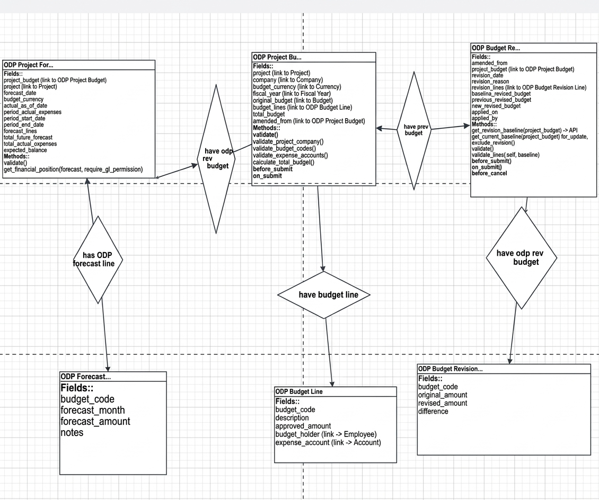

# ODP Investing Module - Architecture & Flow

## 1. Overview 
The **ODP Investing** module manages the complete lifecycle of project investments. 
It connects the strategic planning phase (ODP Project Budget) with the operational financial control in ERPNext (ERPNext Budget), while enabling dynamic adjustments through a robust Revision process, continuous financial tracking via Forecasts, and a unified visual representation via the Financial Dashboard and comprehensive Reports.

## 2. Doctypes & Data Model

### A. ODP Project Budget (Master Document)
* **Purpose:** The primary planning document created by the investment/project team to define the initial budget.
* **Workflow:** Draft -> Approved (Submit).
* **Key Fields:** `project`, `company`, `fiscal_year`, `budget_currency`, `erpnext_budget` (Link).
* **Key Methods:**
  * `validate()`: Validates mandatory fields, ensures project/company match, prevents duplicate budget codes, and validates that expense accounts exist, are not groups, and are not disabled.
  * `calculate_total_budget()`: Automatically sums the approved amounts in the budget lines.
  * `on_submit()`: Aggregates line amounts by Expense Account and automatically creates a **Draft ERPNext Budget** for financial control, then links it via `erpnext_budget`.

### B. ODP Budget Line (Child Table)
* **Purpose:** The detailed breakdown of the budget.
* **Linked to:** `ODP Project Budget`.
* **Key Fields:** `budget_code`, `description`, `approved_amount`, `expense_account`.

### C. ODP Budget Revision (Master Document)
* **Purpose:** Used when an approved budget needs to be modified (e.g., reallocation of funds).
* **Workflow:** Draft -> Pending Finance -> Finance Reviewed -> Applied (Submitted).
* **Key Methods:**
  * `validate()`: Ensures the revision is based on the *latest active* ERPNext Budget. Prevents "silent baseline switching" if a new budget was applied while the user was preparing the revision.
  * `_get_current_baseline()`: Fetches the current active ERPNext Budget and reconciles it with ODP lines.
  * `_validate_lines()`: Ensures all source codes are covered, no duplicates exist, amounts are positive, and at least one line changes before approval.
  * `on_submit()`: The core transaction. It locks the source, cancels the old ERPNext Budget, creates a new one with the revised amounts, submits it, and updates the ODP Project Budget link to point to the new Budget.

### D. ODP Budget Revision Line (Child Table)
* **Purpose:** Shows the delta (difference) between the old and new budget.
* **Linked to:** `ODP Budget Revision`.
* **Key Fields:** `budget_code`, `original_amount`, `revised_amount`, `difference`.

### E. ODP Project Forecast (Master Document)
* **Purpose:** Tracks actual financial performance vs. approved budget for a specific reporting period, and allows planning for future expenses.
* **Key Methods:**
  * `validate()`: Calls `get_financial_position()` to populate read-only fields.
  * `get_financial_position()`: The "engine" of the forecast. It pulls actual expenses from `GL Entry` (General Ledger) and calculates:
    * `period_actual_expenses`: Posted expenses within the selected period.
    * `total_actual_expenses`: Cumulative expenses from FY start to period end.
    * `expected_balance`: Approved Budget - Cumulative Actual - Future Forecast.

## 3. Financial Dashboard
* **Purpose:** Provides a visual, high-level summary of the financial position for a specific Project and Forecast period.
* **Backend (`odp_finance.py`):**
  * Endpoint: `get_dashboard_data(project, project_forecast)`.
  * **Security:** Enforces strict server-side validation to ensure the selected Forecast actually belongs to the selected Project (client-side filters are not trusted).
  * **Reusability:** Reuses the exact calculations of the `ODP Project Financial Summary` report to prevent code duplication and ensure data consistency.
* **Frontend (`odp_finance.js`):**
  * **Filters:** Project and Project Forecast (dynamic filtering).
  * **Visuals:** 6 summary cards (Original Budget, Current Approved, Period Actual, Cumulative Actual, Future Forecast, Expected Balance) + 3 Custom Bar Charts + Detailed Data Table.
  * **UX/UI:** Highlights negative balances in red (for overruns), handles loading states gracefully, and prevents race conditions if the user changes filters while data is loading.

## 4. Reports

### A. ODP Project Financial Summary
* **Purpose:** Provides a detailed, code-level breakdown of the financial position (Budget vs. Actual vs. Forecast).
* **Key Features:**
  * Uses `get_financial_position()` to ensure calculations are identical to the `ODP Project Forecast` form.
  * Enforces `GL Entry` read permissions to protect sensitive accounting data.
  * Displays columns for: Original Budget, Revision Change, Current Approved, Period Actual, Cumulative Actual, Future Forecast, and Expected Balance.
  * Includes a "TOTAL" row at the bottom.
  * **Summary:** Displays 6 KPI cards above the report.
  * **Chart:** Renders a **Donut Chart** (if all values are positive) showing the distribution of Actual vs. Forecast vs. Balance.

### B. Monthly Forecast Report 
* **Purpose:** Visualizes future planned expenses broken down by month and budget code.
* **Key Features:**
  * Dynamically generates columns for every month between the first and last forecast month entered by the user.
  * Groups forecast amounts by `Budget Code + Month`.
  * Displays a "TOTAL" row for the grand total and monthly totals.
  * **Summary:** Displays 3 KPI cards (Total Forecast, Number of Budget Lines, Forecast Months).
  * **Chart:** Renders a **Bar Chart** showing the monthly forecast distribution.

## 5. Integration with ERPNext 
* **ERPNext Budget:** The standard DocType used to control expenses. 
  * Created automatically from `ODP Project Budget`.
  * Replaced automatically via `ODP Budget Revision`.
* **Project & Company:** The core links ensuring data isolation and correct accounting scopes.
* **GL Entry (General Ledger):** Used as the absolute source of truth for actual expenses in the Forecast module.
* **Fiscal Year:** Ensures all periods and revisions fall within the correct accounting timeline.

## 6. The Full Lifecycle 

1. **Planning :** 
   * User creates `ODP Project Budget` -> Submits it.
   * System creates a `Draft Budget` in ERPNext.
   * Finance reviews and submits the ERPNext Budget.
2. **Execution :** 
   * Operations team books expenses (Purchase Orders, Expenses, etc.) against the Project in ERPNext. These post to `GL Entry`.
3. **Monitoring :**
   * User creates `ODP Project Forecast` for a specific period (e.g., Q1).
   * System pulls actuals from GL and calculates the remaining expected balance.
   * User opens the `ODP Financial Dashboard` to view a visual summary of Budget vs. Actual vs. Forecast.
   * User can dive deeper using `ODP Project Financial Summary` (detailed table) or `Monthly Forecast Report` (monthly breakdown).

## 7.  Testing & Verification
"End-to-End Workflow Verification (Success):

**Scenario: Executing a Budget Revision after Finance Review.**

*Action: Clicked "Apply Revision".*

Observation: The system successfully executed the transactional logic:

1. The old ERPNext Budget (BUDGET-2026-00002) was automatically Cancelled.
2. A new ERPNext Budget was Created and Submitted.
3. The ODP Project Budget link (erpnext_budget) was seamlessly updated to point to the new Budget.
4. The Audit fields (previous_erpnext_budget, new_erpnext_budget) in the Revision document were populated correctly.
*Conclusion*: The on_submit logic in ODPBudgetRevision works perfectly and ensures data integrity without manual intervention."

## Dashboard Verification (Success):

**Action: Loaded the ODP Financial Dashboard after applying the Budget Revision.**

*Observation*:

The Dashboard accurately reflects the post-revision data.

Current Approved Budget correctly updated from 510,000 to 1,000 EGP.

Expected Balance was calculated correctly (1,000 - 0 - 500 = 500 EGP).

The visual charts (Bar Charts) scaled perfectly based on the new figures.

Crucially, the backend successfully fetched the newly generated ERPNext Budget (BUDGET-2026-00002-1) and linked it to the forecast.

*Conclusion*: The integration between the Budget Revision, Forecast, and Dashboard is fully functional and consistent.
### A. Strengths 
*   **Centralized Calculation Logic (Single Source of Truth):** The `get_financial_position()` function is heavily utilized by both the `ODP Project Forecast` form and the `ODP Project Financial Summary` report. This prevents discrepancies between what the user sees in the form and what the report calculates.
*   **Robust Concurrency Control:** The use of `for_update=True` in the `ODP Budget Revision` baseline fetching prevents Race Conditions. If two users try to apply a revision simultaneously, the system locks the database rows to ensure data integrity.
*   **Strict Server-Side Validation:** The Dashboard API (`get_dashboard_data`) does not trust client-side filters. It re-verifies that the selected Forecast belongs to the selected Project, ensuring data security and preventing unauthorized access.
*   **Graceful Transaction Handling:** The `on_submit` method in `ODPBudgetRevision` uses a "fail-safe" approach. It temporarily clears the link to the old budget, cancels it, creates the new one, and only re-links the source after successful submission. If any step fails, the entire DB transaction rolls back.
### B. General Application Structure
*   The separation of concerns is well-maintained. Backend logic (Python) handles data validation and DB mutations, while Frontend (JS) handles visual presentation.
*   The use of `frappe.whitelist()` and `check_permission()` is applied consistently across all custom endpoints, indicating a strong security-first approach.
